<div align="center">



# ⚡ Awesome Operational Analytics 📊

[](https://awesome.re)
[](https://github.com/ishandutta2007/Awesome-Operational-Analytics)
[](https://creativecommons.org/publicdomain/zero/1.0/)
[](http://makeapullrequest.com)

**Curated list of production-grade SaaS products, enterprise observability suites, and top open-source GitHub engines for real-time operational analytics, telemetry intelligence, log inspection, and automated operations.**

*Operational Analytics connects real-time telemetry (logs, metrics, APM traces) with core business operations, empowering DevOps, SREs, RevOps, and Data Engineering teams to detect anomalies, automate incident remediation, and optimize performance before it impacts users.*

</div>

---

## 🧭 Table of Contents

- [🌐 Sector Overview & Market Dynamics](#-sector-overview--market-dynamics)
- [🏢 SaaS & Hosted Platforms](#-saashosted-platforms)
- [🔓 Open-Source GitHub Projects](#-open-source-github-projects)
- [🏗️ Architectural Stack Recommendations](#-architectural-stack-recommendations)
- [🤝 How to Contribute](#-how-to-contribute)
- [⚖️ Disclaimer & Licensing](#-disclaimer--licensing)

---

## 🌐 Sector Overview & Market Dynamics

> The global operational analytics market is estimated at **$18.5 Billion in 2024–2025** and is projected to expand to **over $45 Billion by 2030** at a compound annual growth rate (CAGR) of **~16.8%**.  
> The sector exhibits **moderate fragmentation with tier-1 market concentration**—hyperscale platforms (Microsoft Power BI, Splunk/Cisco, Datadog, Tableau/Salesforce) control disproportionate enterprise market share, while emerging modern data-stack players and high-efficiency open-source alternatives (OpenObserve, SigNoz, Superset) are rapidly capturing high-volume, cost-conscious data teams.

---

## 🏢 SaaS/Hosted Platforms

The following table benchmarks category-leading commercial and cloud-hosted operational analytics suites, ordered by enterprise scale (**Revenue / Market Valuation, descending**):

| Product | Company Scale (Revenue / Valuation) | Starting Pricing (Paid Tiers) | Free Tier / Free Trial Limits | Key Operational Focus |
|:---|:---|:---|:---|:---|
| **[Microsoft Power BI](https://powerbi.microsoft.com/)** | **~$3.0+ Trillion Market Cap** *(Microsoft parent; Power BI estimated $4B–$5B+ ARR)* | **$10.00 / user / month** (Power BI Pro); **$20.00 / user / month** (Power BI Premium per user) | **Free Forever plan** (Power BI Desktop: build reports locally; 1 GB per-user storage workspace for personal publishing) | Enterprise operational dashboards, broad Microsoft 365 / Fabric integration, live Power Query telemetry |
| **[Tableau](https://www.tableau.com/)** | **~$280 Billion Market Cap** *(Salesforce parent; Tableau division ~$2.5B+ ARR)* | **$75.00 / user / month** (Tableau Creator, billed annually); Viewer from $15.00 / user / month | **14-Day Free Trial** (Full Creator feature access); **Tableau Public** (Free forever for public workbooks up to 10 GB) | Rich visual operational analytics, relational and warehouse query performance, enterprise self-service BI |
| **[Looker](https://looker.com/)** | **~$2.1+ Trillion Market Cap** *(Alphabet parent; Google Cloud BI division ~$800M+ ARR)* | **$5,000.00 / platform / month** (Looker Standard Platform base fee + per-user license tiers) | **30-Day Free Trial** (via Google Cloud Platform credit trial with $300 in credits) | LookML semantic modeling, single source of governed truth, real-time SQL execution directly on BigQuery/Snowflake |
| **[Splunk](https://www.splunk.com/)** | **$28 Billion Valuation** *(Acquired by Cisco; ~$4.2B ARR)* | **$150.00 / GB / month** (Splunk Enterprise Workload units / log ingest starting packages) | **60-Day Free Trial** (Splunk Enterprise with full enterprise features indexed up to 500 MB/day; converts to Free forever 500 MB/day license) | Machine data analytics, automated root-cause detection, security information and event management (SIEM), ITSI |
| **[Workday Operational Analytics](https://www.workday.com/)** | **~$65 Billion Market Cap** *(~$7.3B ARR)* | **$100.00 / employee / year** (Starting Workday core module add-on; enterprise contracts typically start at $50,000/yr) | **30-Day Guided Enterprise Sandbox Trial** (Enterprise demo tenant with simulated organizational and operational data) | Unified HR, financial ledger, and operational process analytics; native ERP workflow triggers |
| **[Datadog](https://www.datadoghq.com/)** | **~$40 Billion Market Cap** *(~$2.6B ARR)* | **$15.00 / host / month** (Pro Infrastructure tier); APM starts at **$31.00 / host / month** | **14-Day Free Trial** (Unlimited hosts, metrics, APM, log indexing, and synthetic monitoring during trial period) | Full-stack cloud observability, infrastructure monitoring, Watchdog AI automated anomaly diagnosis, OpenTelemetry pipelines |
| **[Qlik Sense](https://www.qlik.com/)** | **~$10 Billion Valuation** *(Thoma Bravo portfolio; ~$1.1B ARR)* | **$20.00 / user / month** (Standard Cloud tier, minimum 10 users = $200/mo) | **30-Day Free Trial** (Qlik Cloud Business trial with up to 5 users and full associative engine exploration) | Associative calculation engine, in-memory cross-data-source exploration, automated operational alerting |
| **[Sisense](https://www.sisense.com/)** | **~$1.5 Billion Valuation** *(Private; ~$160M ARR)* | **$10,000.00 / year** (Starting baseline deployment for Sisense Cloud / Embedded analytics packages) | **30-Day Free Trial** (Full access to Sisense Fusion analytical modeling suite with sample datasets) | Embedded analytics, Fusion Data Server for cross-database aggregation, low-code operational dashboards |
| **[Domo](https://www.domo.com/)** | **~$350 Million Market Cap** *(~$320M ARR)* | **$300.00 / month** (Starting standard consumption tier covering up to 3 users and core cloud connectors) | **30-Day Free Trial** (Full platform functionality with access to 1,000+ pre-built cloud connectors) | High-speed cloud executive dashboards, drag-and-drop Magic ETL, real-time alert triggers for operational teams |
| **[ThoughtSpot](https://www.thoughtspot.com/)** | **~$4.5 Billion Valuation** *(Private; ~$180M ARR)* | **$1,250.00 / month** (ThoughtSpot Team Edition package); Embedded edition custom tier | **30-Day Free Trial** (Full cloud trial connecting directly to cloud data warehouses with up to 5 users) | Search-driven natural language analytics, ThoughtSpot Sage AI copilot, automated metric variance drivers |

---

## 🔓 Open-Source GitHub Projects

The following table lists top open-source repositories powering modern operational analytics, observability, and dashboarding, sorted by **GitHub Stars (descending)**:

| Project | GitHub Stars (Live Badge) | Primary License | Architecture & Key Capabilities |
|:---|:---:|:---:|:---|
| **[Grafana](https://github.com/grafana/grafana)** | [](https://github.com/grafana/grafana/stargazers) | AGPL-3.0 | The de facto open-source operational visualization standard; powers live dashboards across Prometheus, OpenTelemetry, Loki, PostgreSQL, and InfluxDB with rich alerting rules. |
| **[Apache Superset](https://github.com/apache/superset)** | [](https://github.com/apache/superset/stargazers) | Apache-2.0 | Enterprise-scale BI platform offering 40+ dynamic visualization charts, SQL Lab IDE, granular row-level security (RLS), and native integration with Trino, ClickHouse, Snowflake, and BigQuery. |
| **[Metabase](https://github.com/metabase/metabase)** | [](https://github.com/metabase/metabase/stargazers) | AGPL-3.0 | Fast-setup, user-friendly operational business intelligence; provides visual no-code query builders, auto-generated exploration dashboards, pulse alerts, and embedded analytics. |
| **[SigNoz](https://github.com/signoz/signoz)** | [](https://github.com/signoz/signoz/stargazers) | Apache-2.0 | Open-source alternative to Datadog built natively on OpenTelemetry and ClickHouse; combines metrics, distributed tracing, and log management in a single responsive UI. |
| **[Grafana Loki](https://github.com/grafana/loki)** | [](https://github.com/grafana/loki/stargazers) | AGPL-3.0 | Horizontally scalable, multi-tenant log aggregation system inspired by Prometheus; indexes metadata labels rather than full text to minimize storage and operational overhead. |
| **[Redash](https://github.com/getredash/redash)** | [](https://github.com/getredash/redash/stargazers) | BSD-2-Clause | Lightweight, developer-focused SQL query interface and operational dashboard builder; connects natively with dozens of relational, NoSQL, and time-series data engines. |
| **[DataEase](https://github.com/dataease/dataease)** | [](https://github.com/dataease/dataease/stargazers) | GPL-3.0 | Open-source data visualization and operational analysis tool with drag-and-drop report layout, extensive template library, and cross-database query aggregation. |
| **[OpenObserve](https://github.com/openobserve/openobserve)** | [](https://github.com/openobserve/openobserve/stargazers) | AGPL-3.0 | High-performance Rust-based observability engine replacing Splunk and Datadog; delivers **~140x lower storage costs** via Apache Arrow/Parquet on object storage (S3/GCS/MinIO) for logs, metrics, and traces. |
| **[Cube](https://github.com/cube-js/cube)** | [](https://github.com/cube-js/cube/stargazers) | Apache-2.0 | Universal semantic layer and caching engine for operational analytics; provides consistent metric definitions, pre-aggregations, access control, and REST/GraphQL/SQL APIs. |
| **[HyperDX](https://github.com/hyperdxio/hyperdx)** | [](https://github.com/hyperdxio/hyperdx/stargazers) | MIT | Developer-first observability platform centralizing logs, session replays, traces, and metrics; correlates browser console logs and DOM sessions directly with backend microservice failures. |
| **[Evidence](https://github.com/evidence-dev/evidence)** | [](https://github.com/evidence-dev/evidence/stargazers) | MIT | Code-first, analytics-as-code BI framework; compiles Markdown and SQL into interactive, lightning-fast static data reports, version-controlled with Git. |
| **[Lightdash](https://github.com/lightdash/lightdash)** | [](https://github.com/lightdash/lightdash/stargazers) | MIT | Modern open-source BI tool built natively around dbt; turns dbt models and semantic YAML definitions into interactive self-service operational dashboards. |
| **[Grafana Tempo](https://github.com/grafana/tempo)** | [](https://github.com/grafana/tempo?style=social&color=white) | AGPL-3.0 | Massively scalable, easy-to-operate distributed tracing backend; requires only object storage to operate and integrates with Jaeger, Zipkin, OpenTelemetry, and Grafana. |
| **[Siglens](https://github.com/siglens/siglens)** | [](https://github.com/siglens/siglens/stargazers) | Apache-2.0 | Micro-index log management and operational telemetry search engine; reduces compute footprint and storage consumption by up to 90% compared to legacy Elasticsearch clusters. |
| **[Uptrace](https://github.com/uptrace/uptrace)** | [](https://github.com/uptrace/uptrace/stargazers) | BSD-2-Clause | Open-source APM tool driven by OpenTelemetry and ClickHouse; monitors system health, tracks distributed transactions, and pinpoints distributed system latency regressions. |

---

## 🏗️ Architectural Stack Recommendations

When architecting a high-throughput, cost-efficient operational analytics platform, teams typically combine telemetry ingestion with analytical semantic layers:

```
┌────────────────────────────────────────────────────────┐
│           Telemetry & Data Sources                     │
│  Applications • Kubernetes • Databases • Cloud APIs   │
└──────────────────────────┬─────────────────────────────┘
                           │ (OpenTelemetry / FluentBit)
                           ▼
┌────────────────────────────────────────────────────────┐
│         High-Efficiency Telemetry Ingestion            │
│      OpenObserve (Logs/Traces) • SigNoz • Loki         │
│         Parquet / ClickHouse / S3 Storage Tier         │
└──────────────────────────┬─────────────────────────────┘
                           │ (SQL / PromQL / Semantic API)
                           ▼
┌────────────────────────────────────────────────────────┐
│         Governance & Semantic Modeling Layer           │
│              Cube.js  •  dbt  •  LookML                │
└──────────────────────────┬─────────────────────────────┘
                           │
                           ▼
┌────────────────────────────────────────────────────────┐
│       Real-Time Operational Dashboards & Alerts        │
│       Grafana (SRE/DevOps) • Metabase / Superset (BI)  │
└────────────────────────────────────────────────────────┘
```

1. **High-Volume Telemetry & Log Ingestion**: Use **OpenObserve** or **SigNoz** to reduce log storage costs by up to 140x compared to legacy Elastic/Splunk clusters.
2. **Infrastructure & Incident Response**: Deploy **Grafana** paired with Prometheus and Loki for real-time alerts, SLA monitoring, and node-level drilldowns.
3. **Business & Operational Intelligence**: Use **Apache Superset** for complex SQL queries across warehouses (ClickHouse, Snowflake), or **Metabase** for non-technical team member self-service.
4. **Governed Metrics**: Deploy **Cube** or **Lightdash** to lock down mission-critical metric definitions in version control.

---

## 🤝 How to Contribute

Contributions are warmly welcomed! To suggest a new tool or revise existing information:

1. 🍴 **Fork** this repository.
2. 🌿 Create a feature branch: `git checkout -b feature/add-tool-name`
3. 📝 Add or update entries in `README.md` maintaining alphabetical or tabular rank sorting.
4. 💡 Ensure factual descriptions, official documentation links, exact pricing tiers, and correct badge URLs.
5. 🚀 Submit a pull request with a descriptive summary of changes.

---

## ⚖️ Disclaimer & Licensing

- **Community-Curated**: This list is assembled for educational and technical reference purposes. Product names and logos are trademarks of their respective owners.
- **Data Security Notice**: Operational telemetry often processes sensitive machine data, authentication tokens, and user metadata. Always apply field-level masking, RBAC, and encryption before routing production logs.
- **Licensing Compliance**: Always review open-source repository licenses (AGPL-3.0, Apache-2.0, MIT, GPL-3.0) for compliance with your organization's deployment guidelines.

---

<div align="center">

**[⭐ Star this repository](https://github.com/ishandutta2007/Awesome-Operational-Analytics/stargazers) if you found it valuable!**

*Maintained with ❤️ for SREs, Data Engineers, DevOps Specialists, and Operations Leaders.*

</div>
